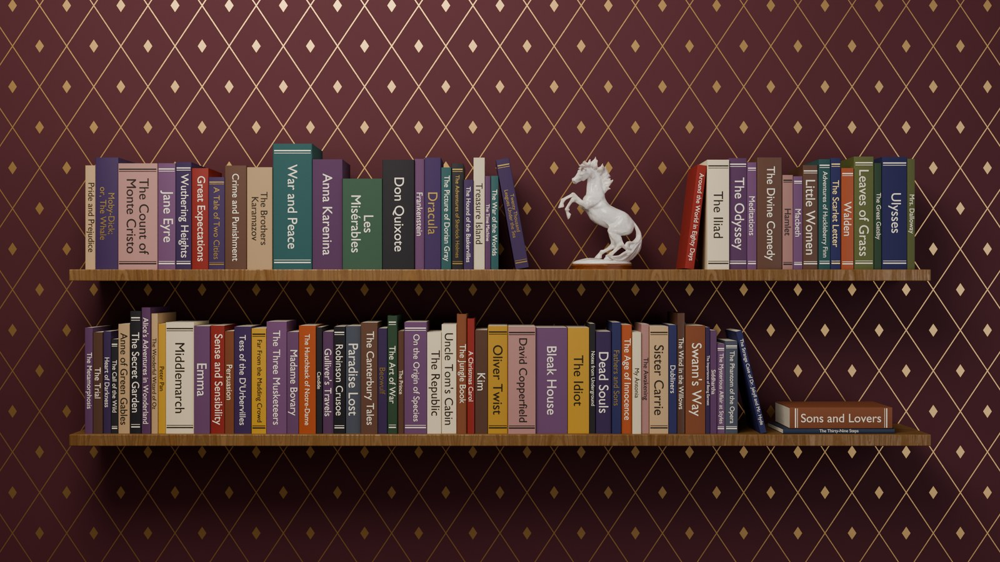

# Bookshelf

Turn your Goodreads reading list into a rendered 3D bookshelf in Blender.



Every book in your list becomes a book on the shelf: its thickness comes from the page count, its
title is printed on the spine, and the shelves, camera and lights resize themselves to fit however
many books you have.

There are two ways to use it:

- **In your browser.** Open the website, choose your CSV, and download the picture. Nothing to
  install, and your file never leaves your computer.
- **In Blender.** Open the template file for a path-traced render you can restyle as you like.

## In your browser

The site lives in [`docs/`](docs/) and is plain static files, so GitHub Pages can host it for free.
Once Pages is switched on (see below) it is at <https://drburke-droid.github.io/Bookshelf/>.

1. Export your library from Goodreads (*My Books → Tools → Import and export → Export Library*).
2. Choose the CSV on the page, or drop it anywhere on it.
3. Pick the books, order, colours and picture shape.
4. Choose a scene: Classic parlour, Old library, Modern gallery, Cool study, Sunlit room or
   Evening lamp. Each sets the wall, shelf finish, lighting and colours together, and you can then
   change any of them on its own.
5. Optionally show your own star ratings in the picture with **Show ratings**:
   - *Top rated on the top shelf* puts five-star books on the top shelf, then four, and so on, and
     labels every shelf.
   - *Stars on spines* prints each book's stars, small, at the foot of its spine.
6. Click **Download picture**.

To switch the site on: in the repository on GitHub go to *Settings → Pages*, set **Source** to
*Deploy from a branch*, choose the `main` branch and the `/docs` folder, and save.

To try it on your own computer:

```bash
python3 -m http.server 8000 --directory docs
```

Then open <http://localhost:8000>.

The site draws the shelf with [three.js](https://threejs.org) (MIT licence, included in
`docs/vendor`). It uses the same layout rules as the Blender script, so both give the same kind of
shelf, though the exact arrangement differs. Scenes, authors on spines and the other finishing
touches below are on the website only.

What makes the website's picture look less computer-made:

- Spines are curved and carry the author, a publisher's emblem, reading creases and rubbed edges.
- Covers are cloth, matte or glossy, and books sit very slightly askew.
- Light comes from sized lamps, spotlights or a window, with soft shadows and reflections.
- Wallpaper has a sheen and a fine texture; wood panelling has real depth.

## In Blender

You need [Blender](https://www.blender.org/download/) 4.2 or newer (made and tested with 5.0).

1. **Export your books from Goodreads.** On the Goodreads website go to *My Books*, then
   *Tools → Import and export → Export Library*, and download `goodreads_library_export.csv`.
2. **Download and open [`bookshelf_template.blend`](bookshelf_template.blend).**
3. **Allow the script to run.** Blender shows a warning that it blocked a Python script. Click
   **Allow Execution**. (No warning? See [If the Bookshelf tab is missing](#if-the-bookshelf-tab-is-missing).)
4. **Open the Bookshelf tab.** With the mouse over the 3D view press **N**, then click the
   **Bookshelf** tab on the right edge.
5. **Choose your CSV** with the folder button under *1. Choose your book list*.
6. Click **Build Bookshelf**.
7. Click **Render Image** (or press F12). When it finishes, save it with *Image → Save As*.

Leave the book list empty to build from the 90 classics included in the file.

## Options

| Setting | What it does |
| --- | --- |
| Books | Which Goodreads shelf to use: Read, Currently reading, Want to read, or All. |
| Year read | Only books finished in that year, for a "my year in books" picture. 0 means every year. |
| Limit | Use at most this many books. 0 means no limit. |
| Order | Date read, author, title, thickness, your rating, cover colour, shuffled, or as in the file. |
| Style | Floating shelves, or a bookcase with sides, top and back. |
| Shelves | Number of shelves. 0 picks the number that fills the picture best. |
| Colours / Colour by | Cover palette, and whether books by the same author share a colour. |
| Thickness | Makes every book thicker or thinner. |
| Variation | A different mix of colours, leaning books and decorations each time you change it. |
| Wall / Wallpaper pattern | Wall colour, and the diamond pattern on or off. |
| Titles on spines / Shorten long titles / Font | Spine lettering. Pick a `.ttf` or `.otf` file to change the typeface. |
| Leaning books / Flat stacks / Decorations | The small touches that make a shelf look lived in. |
| Frame camera / Fit wall and lights | Turn these off to keep your own camera, wall or lighting. |

Goodreads does not include cover art in its export, so cover colours are chosen for you.

The picture's shape decides the shelf layout. Change the resolution in *Output Properties* (for
example 1080 x 1920 for a phone wallpaper) and build again.

## Other book lists

Any CSV with a `Title` column works. These columns are used when present (other names in brackets):

- `Author` (`Authors`)
- `Number of Pages` (`Pages`, `Page Count`)
- `Exclusive Shelf` (`Read Status`)
- `Date Read` (`Last Date Read`)
- `My Rating` (`Star Rating`)
- `Binding` (`Format`)

A missing page count gets a typical thickness. StoryGraph exports work as they are.

Titles in most scripts (Cyrillic, Greek, Chinese, Japanese, Korean) are drawn with Blender's own
fallback fonts. Right-to-left scripts such as Arabic and Hebrew are not shaped correctly.

## Your own decorations

Decorations come from the **Bookshelf Props** collection. To add one, create a collection inside
it and put your object there, standing on the world origin and facing the -Y direction. It is
scaled down automatically if it is too tall for a shelf.

## If the Bookshelf tab is missing

- Open the **Scripting** workspace (tabs along the top), make sure `bookshelf_generator.py` is
  showing in the text editor, and click the **Run Script** button (▶). Then go back to *Layout*.
- Or install the script once as an add-on so it is always there: *Edit → Preferences → Add-ons →
  Install from Disk* and pick [`bookshelf_generator.py`](bookshelf_generator.py). As an add-on it
  works in any scene, with plain materials and no decorations. Delete the default cube first, as
  it sits where the shelves go.

## Credits

The decorations and the shelf wood are CC0 assets from [Poly Haven](https://polyhaven.com):
`potted_plant_04`, `standing_picture_frame_02`, `ceramic_vase_01`, `carved_wooden_elephant`,
`marble_bust_01`, `horse_statue_01`, `concrete_cat_statue` and `oak_veneer_01`. Everything else in
the template is generated by the script.

## Rebuilding the template

`bookshelf_template.blend` is built by a script, so it can be recreated from nothing:

```bash
python tools/fetch_assets.py assets models potted_plant_04 standing_picture_frame_02 ceramic_vase_01 carved_wooden_elephant marble_bust_01 horse_statue_01 concrete_cat_statue
```

```bash
python tools/fetch_assets.py assets textures oak_veneer_01
```

```bash
blender -b --factory-startup --python tools/build_template.py -- assets bookshelf_template.blend
```

Optionally, so the file opens with the Bookshelf tab selected and the camera view filling the window:

```bash
blender --enable-autoexec bookshelf_template.blend --python tools/finish_ui.py
```

The website's decorations are exported from the template:

```bash
blender -b bookshelf_template.blend --python tools/export_web_assets.py -- docs/assets/props
```
